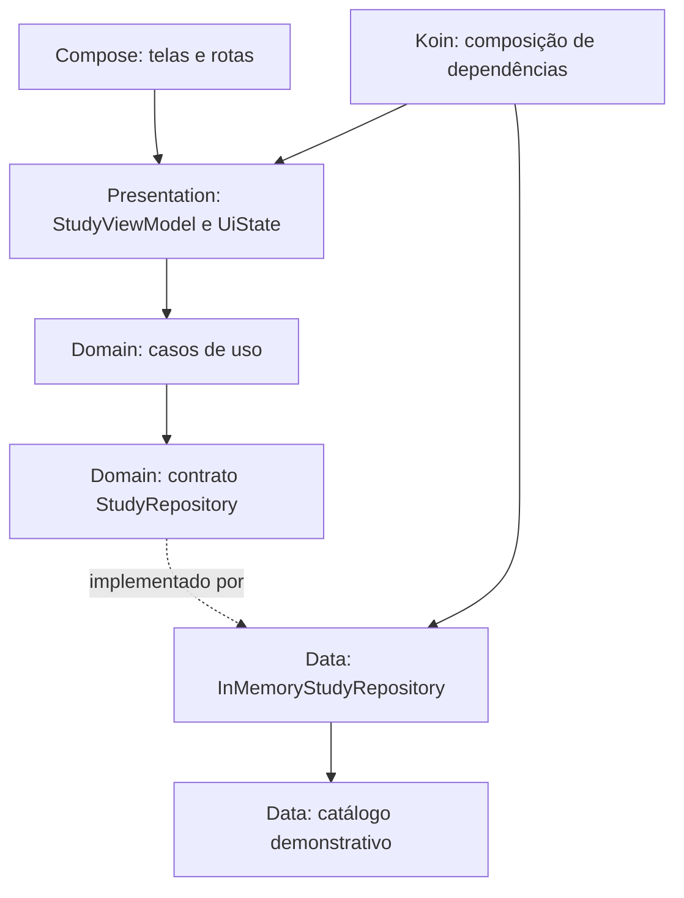

# Arquitetura do Revysa

## Visão geral

O app mantém um único módulo Gradle multiplataforma e separa responsabilidades por pacotes em `commonMain`. A interface compartilhada continua servindo Android e Desktop.

## Responsabilidades

- `domain/model`: materiais, capítulos, cartões, notas, estado do estudo e avaliação de revisão. Não importa Compose nem infraestrutura.
- `domain/repository`: contrato para observar e alterar materiais, progresso, cartões, notas e resultados de quiz.
- `domain/usecase`: operações da aplicação, validações e cálculo do próximo intervalo de revisão.
- `data/demo`: catálogo fixo e repositório em memória. O repositório publica alterações por `StateFlow` e mantém um snapshot serializável para restauração durante recriação da Activity; não grava em disco nem em backend.
- `presentation`: `StudyViewModel` publica `UiState` selado (`Loading`, `Error`, `Empty`, `Success`) e encaminha ações aos casos de uso.
- telas Compose recebem dados e callbacks. Rotas coletam o estado do ViewModel e o convertem para os modelos de apresentação já usados pelas telas.

## Estado e injeção

O ViewModel multiplataforma usa `viewModelScope` e expõe `StateFlow`. Koin monta o repositório demonstrativo, os casos de uso e o ViewModel em `commonMain`. O escopo do ViewModel acompanha o destino de navegação; o repositório dura pela sessão do app.

As telas de login/cadastro continuam demonstrativas e locais à apresentação: não há autenticação nem persistência de credenciais. Busca, seleção do quiz e campos de formulário são estado de interação da tela; operações que alteram o estudo passam pelo ViewModel e pelos casos de uso.

## Revisão espaçada

Cada cartão guarda `intervalDays` e `nextReviewAtEpochMillis`. Cartões novos começam sem intervalo agendado e estão disponíveis para revisão. Após a avaliação, o caso de uso usa o intervalo anterior (ou um dia na primeira avaliação) e aplica:

| Avaliação | Próximo intervalo |
| --- | --- |
| Errei | 1 dia |
| Difícil | intervalo × 1,5 |
| Acertei | intervalo × 2 |
| Fácil | intervalo × 3 |

Intervalos fracionários são mantidos. O relógio é uma dependência injetada para permitir testes determinísticos. A fila contém cartões cujo horário de revisão chegou; após a avaliação, o cartão sai da fila atual e recebe uma próxima data.

## Decisões e limites

- Camadas em pacotes, em vez de novos módulos Gradle, reduzem alterações de build e mantêm o alvo multiplataforma atual.
- Koin fornece injeção comum a Android/Desktop; ViewModels mantêm estado observável fora das funções de tela.
- O repositório demonstrativo implementa o mesmo contrato que uma futura fonte persistente/remota poderá atender.
- Estado sobrevive a navegação e recriação da Activity enquanto o snapshot puder ser salvo; não há persistência durável após encerramento do processo.
- Backend, banco local, autenticação real e sincronização ficam fora da Sprint 2.

### Alternativas consideradas

- **Módulos Gradle separados por camada:** dariam isolamento de build mais forte, mas aumentariam a mudança estrutural sem benefício necessário para este incremento. As fronteiras de pacote deixam a migração futura possível.
- **Instanciação manual de dependências:** seria suficiente para o conjunto pequeno de objetos, mas não atenderia à exigência de injeção por Koin nem facilitaria trocar o fake pelo repositório da próxima etapa.
- **Estado Compose nos adaptadores de rota:** era a solução da Sprint 1, simples para a demonstração. `StateFlow` em ViewModel foi escolhido para separar ciclo de vida e regras da UI e permitir testes sem renderizar telas.
